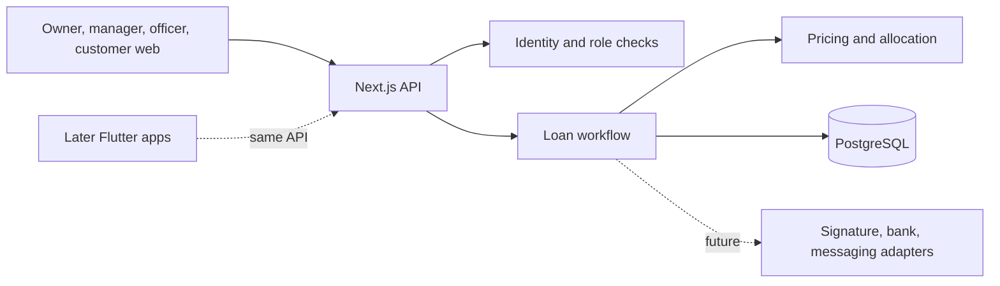
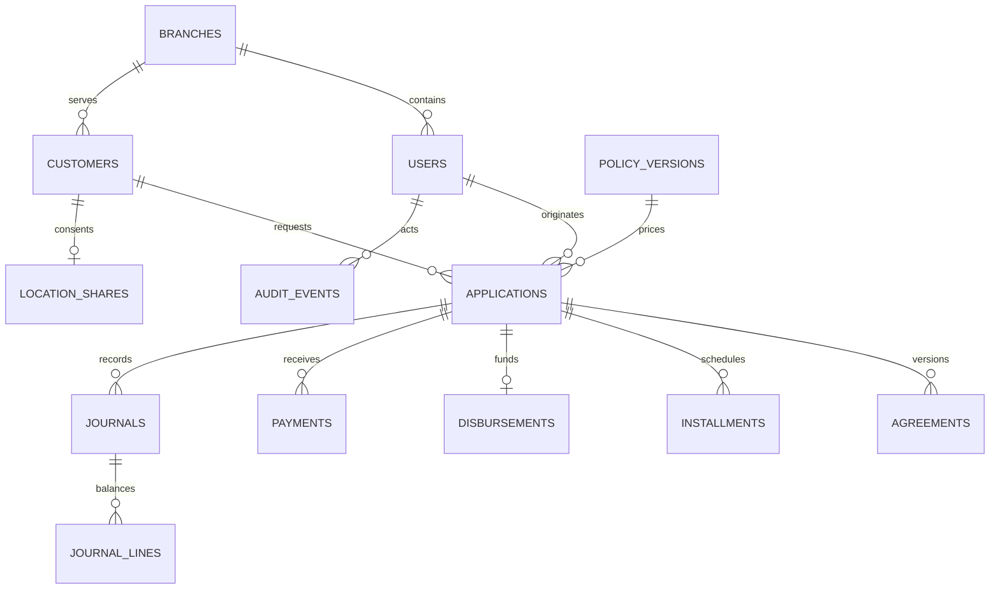
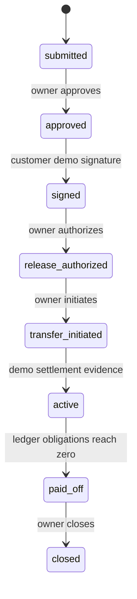

# Product and technical design

## Current monthly intake update (2026-10-25)

The latest user direction supersedes the older weekly example and customer-signing sequence below. The field officer now starts a three-step mobile intake: identity and encrypted KTP/video evidence, monthly amount and schedule, then borrower review and demo signature on the officer's device. A related customer account may open the separate signing page; newly created borrowers do not receive their own login yet. The customer home is blank; the separate `/izin-lokasi` route holds the explicit opt-in/withdrawal controls. Previously consented reporting still runs when the blank page is open. The owner manually reviews evidence and approves only the exact signed terms snapshot before release. A changed agreement requires a new version and signature, but that revision flow is not yet built. Monthly installments begin on the 1st of the month after signing, with principal and total flat interest split across months. Terms show a simple late fee at the policy's monthly rate, initially 5% of original principal, prorated daily with a fixed 30-day divisor after the due date. Fee accrual and payment allocation are not yet implemented, so the demo ledger does not enforce that term. The old weekly route remains for compatibility and tests; it is not the primary UI flow.

## Architecture and module map

The current code is a modular TypeScript monolith: Next.js renders responsive screens and exposes route handlers; `lib/workflow.ts` owns state transitions and transaction boundaries; `lib/finance.ts` owns integer IDR calculations; `lib/location.ts` owns consent and latest-location access; PostgreSQL holds records, journals, and audit events. Future Flutter clients can use the same API after its contract is versioned. External services belong behind identity, signature, bank, and messaging adapters. The two current demo adapters deliberately refuse to run unless `ENABLE_DEMO_ADAPTERS=true`.

Planned module boundaries: identity and branches; customers and verification; products and policy; applications and approval; agreements and activation; disbursement; schedules and repayment; ledger and audit; reporting; consent and notifications. No real provider is selected.

## Data model and ERD

Amounts are integer IDR. Timestamps are stored in UTC; user-facing dates use `Asia/Jakarta`. Policy and agreement snapshots preserve the approved economics.

The schema is in `db/schema.sql`. Customer NIK is reduced to a keyed duplicate-detection hash and last four digits; full account numbers are not retained in this demo. `location_shares` keeps one rounded latest location per consenting customer, never a movement history. A production implementation needs independent encryption keys, verified identity evidence, secure object storage, location retention enforcement, and access controls.

## Permission matrix

| Operation | Owner | Manager | Assigned officer | Customer |
| --- | --- | --- | --- | --- |
| Create borrower and submit application | No | No | Yes, own branch | No |
| View case | All | No | Own originated cases | No customer case screen |
| View latest consented location | All active cases | Active cases in own branch | No | Own status only |
| Change location consent or report location | No | No | No | Own active case only |
| Create policy version | Yes | No | No | No |
| Approve application | Yes | No | No | No |
| Simulate signature through internal API | No | No | No | Yes; no customer UI |
| Authorize, initiate, confirm transfer | Yes | No | No | No |
| Verify repayment and close | Yes | No | No | No |

The API enforces this matrix. The manager role has branch-scoped location read access and no financial actions. The owner role is not yet protected by MFA or high-assurance step-up, so it is a development role only.

## State transitions

No receivable exists at approval or signing. The disbursement journal is created only when the demo bank confirmation action marks the loan active. A production system must require independent settlement evidence from a trusted bank or an authorized manual review workflow.

## Calculation specification

- Policy versions hold min/max principal, flat term interest basis points, and term bounds. The seeded 200 basis points is a **demo value**, not a recommended rate.
- Interest in IDR is `round_half_up(principal × basis_points / 10,000)` using `BigInt` before conversion to a safe JavaScript integer.
- Principal and interest are split across weekly installments; remainders are assigned to the earliest installments. The totals always equal the approved snapshot.
- Payment allocation applies to interest receivable first, then principal. Overpayments stop for review. Partial payment and duplicate bank references are supported or rejected respectively.
- Disbursement journals debit principal receivable and interest receivable, credit cash and interest income. Payment journals debit cash and credit the two receivables. Each journal is checked for balance. This prototype recognizes all flat interest at disbursement; production accounting policy needs review.
- Schedule dates derive from the Jakarta calendar date. Existing agreement snapshots do not change when a new policy version is created.

## Screens and journeys

| Screen | Job | Current state |
| --- | --- | --- |
| Sign in | Enter role-specific local workspace | Working demo session |
| Owner overview | Review receivables, pending and active cases | Working, ledger-backed amounts |
| Loan register | Inspect status, approved schedule, collections | Working |
| Borrower intake | Capture synthetic identity, bank details, encrypted KTP photo and video | Working demo; liveness requires manual review |
| Officer application | Monthly amount and schedule, then borrower demo signature | Working demo on officer device |
| Owner policy | Create new policy version | Working subset |
| Owner decision and transfer | Approve, release, initiate, confirm | Working with demo settlement |
| Customer location | Blank home runs consented reporting; `/izin-lokasi` manages permission and withdrawal | Working foreground web demo |
| Superadmin/manager location | View latest coarse location for active, consented cases | Working branch-scoped demo; no map or boundary |
| Payment and closure | Verify partial/full payment, close case | Working |

Staff journey: complete the three-step intake and hand the signing page to the borrower. Owner journey: review identity evidence, approve the same signed terms, authorize and reconcile transfer, verify payments, close; a separate location view shows current consented reports. Manager journey: view only branch-scoped location reports. Customer web journey: sign in to a blank home; the separately addressable `/izin-lokasi` page provides opt-in, withdrawal, and permission status. Reporting continues only while an enabled customer page remains open. The older internal demo signing API remains for legacy workflow tests.

## Acceptance matrix and milestones

| Gate | Evidence now | Release status |
| --- | --- | --- |
| Arithmetic, schedule, payment allocation | Unit tests | Demo verified |
| Role restrictions and scoped reads | Transaction test and API checks | Demo verified; MFA still required |
| Signature version/hash match | Canonical hash check in workflow test | Demo verified; legal provider missing |
| Disbursement idempotency | Replay test | Demo verified |
| Transfer reconciliation | Demo evidence note only | Blocked for real money |
| Location consent and role separation | Integration and browser tests; rounded latest report only | Foreground demo verified; boundary and background tracking absent |
| Balanced journals and zero-balance closure | Integration test | Demo verified |
| Activation codes, PIN, rate limits, device recovery | Not implemented | Blocked |
| KTP verification, OCR, consent and protected files | Not implemented | Blocked |
| Reversals, refunds, write-offs, rescheduling | Not implemented | Blocked |
| Backup restoration, operational security review | Not run | Blocked |

Milestone 1 is this local vertical slice. Milestone 2 should add real identity and customer-direct activation with encrypted storage, rate limits, MFA, and document handling. Milestone 3 should integrate legal signing and bank settlement with independent reconciliation and reversals. Milestone 4 should complete collections, reports, consent, backup restore exercises, and operational review. Flutter phases follow the stable API and shared domain rules.
